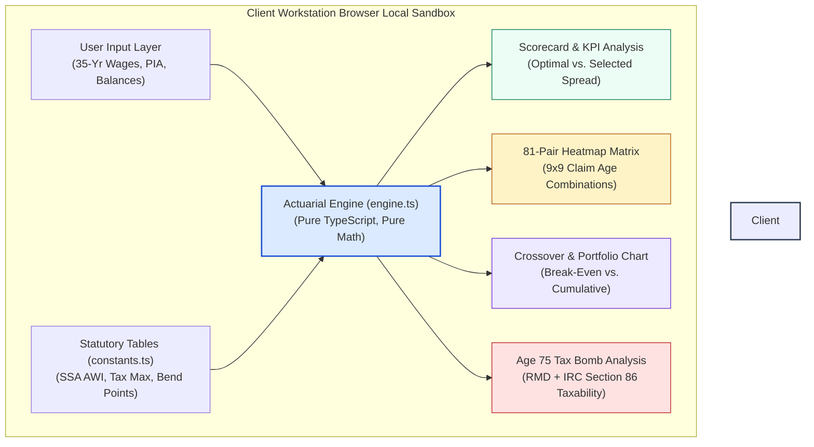
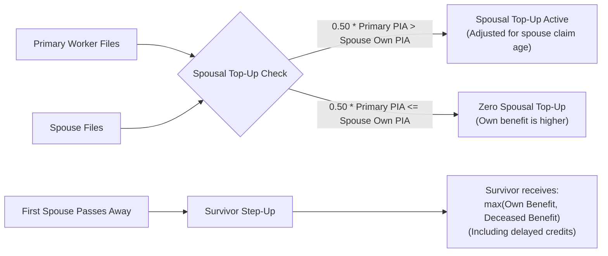
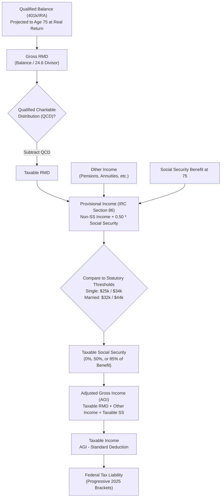
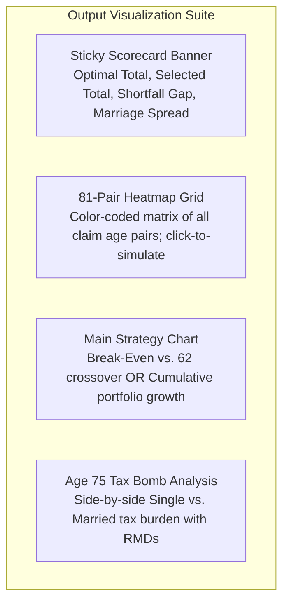

# Social Security Strategy Optimizer v3.0
## Fiduciary Compliance Guide & Actuarial Calculation Specification

```
========================================================================================
EXECUTIVE PRESENTATION DECK & REGULATORY AUDIT REFERENCE
Prepared for Registered Investment Advisors (RIAs), Compliance Officers & Actuaries
========================================================================================
```

---

### Slide 1: System Purpose & Executive Overview

> [!NOTE]
> **Core Purpose**: An institutional-grade, client-side Social Security household claiming optimizer and decumulation tax analysis platform designed for fiduciary wealth management.

#### Key Objectives
- **Household Optimization Across 81 Claiming Pairs**: Simultaneously evaluates all combinations of claiming ages (ages 62 through 70 for both partners) to find the lifetime wealth-maximizing strategy under personalized longevity, inflation, and investment return assumptions.
- **Pure Statutory Actuarial Fidelity**: Encodes Title II of the Social Security Act and IRS Code provisions without approximation shortcuts:
  - 35-year wage-indexed earnings (AIME).
  - Multi-tier progressive bend points (2027 eligibility year: $1,340 and $8,077).
  - Exact monthly reduction factors for early claiming (down to 70% of PIA at 62).
  - Delayed Retirement Credits (DRCs) accruing at +8% per year (up to 124% at 70).
  - Spousal top-ups under post-2015 deemed filing rules.
  - Survivor annuity step-ups to 100% of the deceased spouse's delayed benefit.
- **Retirement Tax Integration ("The Tax Torpedo")**: Evaluates federal income tax liabilities at age 75 when Required Minimum Distributions (RMDs) force up to 85% of Social Security benefits into taxable income under IRC § 86.
- **Client Education & Interactive Visualization**: Bridges the gap between complex actuarial mathematics and client comprehension through interactive heatmaps, break-even crossover trajectories, and side-by-side single vs. married tax comparisons.

---

### Slide 2: Architecture, Privacy & Fiduciary Data Governance

> [!IMPORTANT]
> **Complete Data Confidentiality & Zero Network Exposure**:
> The application executes 100% client-side in the user's web browser (React 19 + TypeScript). No client earnings records, Social Security numbers, qualified account balances, or financial details are ever transmitted over the network or saved to remote servers. This guarantees full compliance with Regulation S-P and the Gramm-Leach-Bliley Act (GLBA).



#### Fiduciary Guardrails & Quality Standards
- **Deterministic Math Engine**: All formulas in `services/engine.ts` are pure functions devoid of random or opaque simulations, enabling external auditors to verify results against SSA actuarial tables.
- **Bound Checking & Range Validation**: Input values are strictly bounded against extreme or degenerate entries (e.g., maximum monthly PIA of $20,000, COLA bounded 0–10%, real return bounded -10% to +20%, life expectancy bounded 40–120).
- **Official SSA Data Maintenance**: Includes `scripts/update_ssa_factors.py`, an automated parser that pulls official National Average Wage Indexing (AWI) tables, contribution limits (Tax Max), and bend point schedules directly from SSA.gov.

---

### Slide 3: Primary Insurance Amount (PIA) & AIME Calculation

> [!NOTE]
> **Legal Authority**: Social Security Act § 215 (42 U.S.C. § 415); 20 C.F.R. § 404.210–404.212.

The engine supports three user input methods for benefit calculation:
1. **Manual PIA**: Direct monthly benefit at Full Retirement Age (FRA).
2. **Manual AIME**: Direct Average Indexed Monthly Earnings, automatically processed through statutory bend points.
3. **Lifetime Earnings History (CSV)**: Full 35-year wage-indexing computation.

```
Step 1: Cap Annual Wages at Historical Tax Max
Wage_Indexed = min(Annual_Earnings, Tax_Max_Year)

Step 2: Calculate Wage Indexing Factor (Prior to Age 60)
Factor_Year = AWI_at_Age_60 / AWI_Year
Indexed_Wage = Capped_Wage * Factor_Year
(Note: Wages earned at or after age 60 are capped at Tax Max with Factor = 1.0)

Step 3: Select Top 35 Years & Derive AIME
AIME = floor( Sum(Top_35_Indexed_Earnings) / 420 )

Step 4: Apply 3-Tier Progressive Bend Points (Eligibility Year 2027)
- Bend Point 1 (B1): $1,340
- Bend Point 2 (B2): $8,077

Tier 1: 90% of AIME up to $1,340
Tier 2: 32% of AIME between $1,340 and $8,077
Tier 3: 15% of AIME above $8,077

Step 5: Statutory Truncation (42 U.S.C. 415(a)(1)(A))
PIA = floor( Raw_PIA * 10 ) / 10  (Truncated down to nearest $0.10)
```

---

### Slide 4: Early Reductions & Delayed Retirement Credits

> [!NOTE]
> **Legal Authority**: Social Security Act § 202(q), § 202(w); 20 C.F.R. § 404.410, § 404.313.

- **Baseline Full Retirement Age (FRA)**: Age 67 for all cohorts born in 1960 and later.
- **Early Claim Reductions**:
  - First 36 months early (ages 64 to 67): 5/9 of 1% (5/900 = ~0.5556%) per month -> 20.0% reduction at age 64.
  - Remaining months (months 37 to 60, ages 62 to 64): 5/12 of 1% (5/1200 = ~0.4167%) per month -> additional 10.0% reduction.
  - Total reduction at age 62: **30.0%** (Worker receives **70.0% of PIA**).
- **Delayed Retirement Credits (DRCs)**:
  - Delayed beyond age 67: 2/3 of 1% (8/1200 = ~0.6667%) per month (8.0% simple per year).
  - Total enhancement at age 70 (36 months delayed): **+24.0%** (Worker receives **124.0% of PIA**).
  - No additional DRCs accrue after age 70.

| Claim Age | Months from FRA (67) | Adjustment Factor | Percentage of PIA | Monthly Check ($3,000 Base PIA) |
| :---: | :---: | :---: | :---: | :---: |
| **62** | -60 | -30.00% | **70.00%** | $2,100 |
| **63** | -48 | -25.00% | **75.00%** | $2,250 |
| **64** | -36 | -20.00% | **80.00%** | $2,400 |
| **65** | -24 | -13.33% | **86.67%** | $2,600 |
| **66** | -12 | -6.67% | **93.33%** | $2,800 |
| **67 (FRA)** | 0 | 0.00% | **100.00%** | $3,000 |
| **68** | +12 | +8.00% | **108.00%** | $3,240 |
| **69** | +24 | +16.00% | **116.00%** | $3,480 |
| **70** | +36 | +24.00% | **124.00%** | $3,720 |

---

### Slide 5: Household Spousal, Survivor, and Deemed Filing Mechanics



#### 1. Spousal Top-Up Formula (42 U.S.C. § 402(b), (c))
- Entitlement: Up to 50% of the primary earner's unreduced PIA (not their delayed benefit), less the spouse's own PIA:
  $$\text{Raw Spousal Top-Up} = \max(0, [0.50 \times \text{PIA}_{\text{Spouse}}] - \text{PIA}_{\text{Own}})$$
- Early Spousal Reductions (if claimed before age 67):
  - First 36 months early: 25/36 of 1% (25/3600 = ~0.6944%) per month (25% reduction at 64).
  - Additional months early: 5/12 of 1% (5/1200 = ~0.4167%) per month (additional 10% reduction).
  - Maximum reduction at age 62: **35.0%** (Spouse receives 32.5% of primary PIA if own PIA is zero).
- Deemed Filing (Bipartisan Budget Act of 2015): Claiming either own or spousal benefit is legally deemed to claim both. Spousal top-up only pays after both spouses have claimed.

#### 2. Survivor Annuity Step-Up Rule (42 U.S.C. § 402(e), (f))
- Upon the death of the first spouse, the surviving spouse steps up to the higher of their own current benefit or the deceased spouse's actual benefit:
  $$\text{Survivor Check} = \max(\text{Benefit}_{\text{Surviving}}, \text{Benefit}_{\text{Deceased}})$$
- **Fiduciary Insight**: The deceased spouse's benefit includes all accrued Delayed Retirement Credits (DRCs). Delaying the higher earner's claim to age 70 establishes an inflation-hedged annuity that survives until the death of whichever partner lives longer.

---

### Slide 6: Multi-Year Simulation & Portfolio Compounding

#### Timeline Compounding Algorithm
For each calendar year from the older partner's age 62 until the death of the last surviving spouse:
1. **Survival Check**: Evaluates whether Partner A and Partner B are alive based on their respective life expectancy inputs.
2. **COLA Compounding**: Adjusts benefits for inflation using the assumed annual COLA:
   $$\text{Inflation Factor}_t = (1 + \text{COLA})^{t - t_{\text{start}}}$$
   *(Note: In "Today's Dollars" mode, effective COLA is held at 0.0% to model real constant purchasing power).*
3. **Benefit Assembly**: Determines annual payouts based on living status (both alive vs. survivor step-up).
4. **Solvency Haircut (Trust Fund Depletion Option)**: Multiplies payable benefits by the user-selected haircut (e.g., 83% payable).
5. **Portfolio Reinvestment Compounding**:
   $$\text{Nominal Return Rate} = (1 + \text{Real Return}) \times (1 + \text{COLA}) - 1$$
   $$\text{Cumulative Wealth}_t = \left( \text{Cumulative Wealth}_{t-1} \times (1 + \text{Nominal Return Rate}) \right) + \text{Annual Benefit}_t$$

---

### Slide 7: 81-Pair Strategy Grid Heatmap & Optimizer

#### Search Space & Combinatorics
- Complete grid evaluation across 81 discrete strategies:
  $$\{62, 63, 64, 65, 66, 67, 68, 69, 70\}_A \times \{62, 63, 64, 65, 66, 67, 68, 69, 70\}_B$$
- Determines:
  - **Optimal Strategy**: The claiming pair $(Age_A^*, Age_B^*)$ that produces the absolute maximum cumulative household wealth.
  - **Worst-Case Strategy**: The lowest-performing claiming pair (typically early claiming in high longevity environments).
  - **Lifetime Spread**: The dollar spread between the optimal and worst-case strategies (often $200,000 to $600,000+).

```
         PARTNER A CLAIM AGE (COLUMNS 62 -> 70)
        62      63      64      65      66      67      68      69      70
  62  [Base]  [+$24k] [+$51k] [+$82k] [+$112k][+$145k][+$172k][+$194k][+$211k]
  63  [+$18k] [+$44k] [+$72k] [+$105k][+$138k][+$172k][+$201k][+$224k][+$242k]
P 64  [+$38k] [+$66k] [+$97k] [+$131k][+$166k][+$202k][+$233k][+$258k][+$278k]
A 65  [+$61k] [+$91k] [+$124k][+$160k][+$197k][+$235k][+$268k][+$295k][+$316k]
R 66  [+$85k] [+$117k][+$152k][+$190k][+$229k][+$269k][+$304k][+$333k][+$356k]
T 67  [+$111k][+$145k][+$182k][+$222k][+$263k][+$305k][+$342k][+$373k][+$398k]
B 68  [+$134k][+$170k][+$209k][+$251k][+$294k][+$338k][+$377k][+$410k][+$437k]
  69  [+$155k][+$193k][+$234k][+$278k][+$323k][+$369k][+$410k][+$445k][+$474k]
  70  [+$173k][+$213k][+$256k][+$302k][+$349k][+$397k][+$440k][+$477k][+OPTIMAL]
```

#### Heatmap Capabilities
- **Direct Click-to-Simulate**: Clicking any cell instantly switches all charts, KPI cards, and tax models to that strategy.
- **Toggle View**:
  - `Spread (+vs Worst)`: Shows incremental dollars gained over the worst strategy.
  - `Total ($M)`: Shows absolute terminal wealth in millions.
- **Preset Shortcuts**: One-click toggles for `Optimal`, `FRA (67/67)`, and `Early (62/62)`.

---

### Slide 8: Age 75 Tax Bomb & RMD Simulator (IRC §§ 72, 86, 401)

> [!WARNING]
> **The Retirement Tax Torpedo**:
> Mandatory RMDs from tax-deferred savings (401k/IRA) at age 75 increase provisional income, causing up to 85% of Social Security benefits to become taxable under IRC § 86 and bumping the household into higher marginal brackets.



#### IRS Provisional Income Formula & Tax Tiers (IRC § 86)
$$\text{Provisional Income} = \text{Taxable RMD} + \text{Other Income} + (0.50 \times \text{Social Security})$$

| Filing Status | Tier 1 Threshold (50% Taxable) | Tier 2 Threshold (85% Taxable) |
| :--- | :---: | :---: |
| **Single** | $25,000 | $34,000 |
| **Married Filing Jointly** | $32,000 | $44,000 |

#### Output Tax Metrics
- **Taxable Social Security ($)**: The exact portion of Social Security included in gross income.
- **Single vs. Married Comparison**: Highlights whether joint filing causes a **Marriage Penalty** (joint tax exceeds combined single taxes) or a **Marriage Bonus**.
- **Effective & Marginal Tax Rates**: Shows both the average tax burden and the top bracket applied.

---

### Slide 9: User Input Dictionary & Control Mapping

| Input Field | Category | Type / Allowed Range | Description & Calculation Impact |
| :--- | :--- | :--- | :--- |
| **Dollar Value Toggle** | Global | `Today's` / `Future` | Toggles between constant purchasing power (0% COLA) and future nominal dollars. |
| **Inflation Rate (COLA)** | Global | Slider (0.0% to 10.0%) | Annual benefit COLA adjustment and nominal return component. |
| **Real Investment Return** | Global | Slider (-10.0% to +20.0%) | Return earned on invested cash flows above inflation. |
| **Apply Solvency Haircut?**| Global | Checkbox & Slider (50%–100%)| Models potential Trust Fund exhaustion (83% standard assumption). |
| **Partner Name** | Profile | Text string | Customizes chart labels, tooltips, and report headers. |
| **Birth Year** | Profile | Number (1900 to 2010) | Determines indexing year (age 60) and Full Retirement Age (67 for 1960+). |
| **Life Expectancy** | Profile | Slider (50 to 105) | Mortality age; triggers survivor step-up when the first spouse passes away. |
| **Claim Age** | Profile | Slider (62 to 70) | User-selected claiming age evaluated in primary charts. |
| **Marital Status** | Profile | Toggle (Single / Married) | Activates spousal top-ups, deemed filing, and survivor step-up rules. |
| **PIA Input Mode** | Profile | `Manual PIA` / `AIME` / `CSV`| Selects direct PIA entry, AIME conversion, or full 35-year wage history. |
| **Qualified Savings** | Tax Bomb | Currency ($) | Starting traditional 401(k)/IRA balance projected to age 75 for RMDs. |
| **Annual Contribution** | Tax Bomb | Currency ($) & Stop Age | Ongoing retirement savings added to qualified accounts until retirement. |
| **Other Income (1, 2, 3)**| Tax Bomb | Currency ($) | Non-SS fixed retirement income (pensions, rental, interest) at age 75. |
| **Charitable Giving (QCD)**| Tax Bomb | Currency ($) | Qualified Charitable Distributions offsetting gross RMDs dollar-for-dollar. |

---

### Slide 10: Visual Analytics & Chart Interpretation Guide



#### 1. Main Strategy Chart Dual Modes
- **Break-Even vs. 62 (Crossover Analysis)**:
  - Subtracts the early claiming baseline (both claiming at age 62) from each strategy.
  - In early years, the curve is negative because delayed claiming pays zero initial checks.
  - The exact point where the curve crosses the horizontal **$0 break-even line** reveals the break-even age where delaying definitively beats early claiming.
- **Cumulative Portfolio Growth**:
  - Plots accumulated portfolio balance under reinvestment.
  - Displays vertical reference pins for Partner A claim age, Partner B claim age, Partner A death, and Partner B death.

#### 2. Sticky Scorecard & KPI Callouts
- **Optimal Strategy Tile**: Shows highest lifetime household wealth and corresponding claim ages.
- **Selected Strategy Tile**: Shows lifetime wealth generated by current input settings.
- **Gap to Optimal**: Clear callout showing dollars left on the table (e.g., `-$142k`).
- **Marriage / Unmarried Spread**: Evaluates the wealth differential between legal marital statuses.

---

### Slide 11: Compliance Auditing, Statutory Authorities & Fiduciary Notices

#### Statutory & Regulatory Authority Cross-Reference
- **Social Security Act § 215(b)** (42 U.S.C. § 415) / 20 C.F.R. § 404.211: *Determination of AIME and 35-year wage indexing.*
- **Social Security Act § 215(a)(1)** / 20 C.F.R. § 404.212: *Statutory bend points and dime truncation.*
- **Social Security Act § 202(q)** / 20 C.F.R. § 404.410: *Early retirement reduction rates.*
- **Social Security Act § 202(w)** / 20 C.F.R. § 404.313: *Delayed Retirement Credits (+8% per year).*
- **Social Security Act § 202(b), (c)** / 20 C.F.R. § 404.330: *Spousal entitlement and reduction schedules.*
- **Bipartisan Budget Act of 2015 § 831**: *Mandatory deemed filing rules eliminating file-and-suspend arbitrage.*
- **Social Security Act § 202(e), (f)** / 20 C.F.R. § 404.335: *Widow(er) survivor annuity step-up rules.*
- **Internal Revenue Code § 86**: *Three-tier provisional income taxation of Social Security benefits.*
- **Internal Revenue Code § 401(a)(9) & SECURE 2.0 Act**: *Age 75 RMD divisors and Uniform Lifetime Table.*

#### Mandatory Fiduciary Client Disclosure
> **Regulatory Notice**: The Social Security Strategy Optimizer is an analytical planning model created for professional financial consultation and educational analysis. It does not constitute an official determination of benefits by the Social Security Administration (SSA) or the Internal Revenue Service (IRS). Projections are mathematical simulations based on published statutory rules and user-selected assumptions regarding inflation, investment returns, and longevity. Fiduciary advisors must verify client earnings histories using official SSA Form SSA-7004 or mySocialSecurity records prior to implementing claiming strategies.
